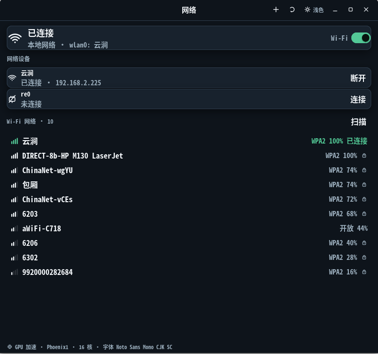

# netcore — FreeBSD 原生网络管理器

netcore 是一个面向 FreeBSD 15.1 的原生网络管理器，采用 Rust 2024 编写。
核心目标是提供与 Linux NetworkManager 类似的使用体验，但使用 FreeBSD 的
系统原语：wpa_supplicant（D-Bus 或控制套接字）、dhclient(8)、
getifaddrs(3) 与 NETLINK_ROUTE，以及 D-Bus 作为稳定的控制面。

界面包括：

- 常驻的 root 守护进程 netcore-daemon
- 命令行客户端 netcore
- GTK4 桌面应用 netcore-gui
- XFCE Panel 插件（Rust，原生 GDBus）
- GNOME Shell 扩展（GJS）
- KDE Plasma 6 小部件（QML/C++）

## 功能

- Wi-Fi 扫描、连接、断开，WPA/WPA2/WPA3-SAE 密码网络
- wpa_supplicant 自动探测：优先 fi.w1.wpa_supplicant1 D-Bus，缺失时回退
  到 /var/run/wpa_supplicant 控制套接字（FreeBSD 默认 ports 构建常常如此）
- 连接成功后启动/接管 dhclient，断开时只停止自己启动的进程
- 监听 NETLINK_ROUTE 的链路与地址事件，并保留 getifaddrs 周期轮询兜底
- 设备状态、IP、MAC、MTU 与 Wi-Fi 信号/安全性统一建模
- 版本化 JSON-over-D-Bus 协议，方便 GJS、QML、shell 调用
- root + wheel 组 + polkit 三层授权；只读接口对所有本地用户开放
- 可选 Capsicum：Netlink 解析器运行在 cap_enter(2) 后的子进程中
- rc.d 服务、D-Bus 激活、polkit action、FreeBSD 安装脚本

## 快速开始

依赖（FreeBSD ports）：

    pkg install gtk4 xfce4-panel dbus polkit
    # 自动编译还需要：
    pkg install rust pkgconf
    # KDE 集成额外需要：
    pkg install qt6-base qt6-declarative qt6-tools
    # dhclient(8) 与 wpa_supplicant 属于 FreeBSD 基本系统

安装有两种一键入口：

    # 1) 自动模式：检测编译环境。完整则自动编译，否则回退到预编译产物。
    sudo ./scripts/install-freebsd.sh

    # 2) 预编译模式：只安装 target/release 已有产物，不调用编译器。
    sudo ./scripts/install-freebsd-prebuilt.sh

    # 只检测环境与产物，不编译、不安装：
    ./scripts/install-freebsd.sh --check

自动模式会检测 cargo、rustc、C 编译器、pkg-config、GTK4、GTK3 和
libxfce4panel；Qt6 可用时同时构建 KDE 插件。编译环境不完整但
target/release 四个核心产物齐全时，会自动改用预编译安装；两者都没有时
打印缺失清单并退出。预编译模式要求当前 checkout 已编译过，缺少 KDE 插件
时会跳过 KDE，但不会启动任何编译命令。

安装后：

    sysrc netcore_enable=YES
    service dbus restart
    service netcore start
    service netcore status
    netcore status

暂存安装：

    DESTDIR=/tmp/netcore-stage ./scripts/install-freebsd.sh

注意：服务文件按 /usr/local 前缀编写。安装到其他 PREFIX 时需要相应修改
D-Bus service 与 .desktop 的 Exec 路径。完整说明见
[docs/installation.md](docs/installation.md)。

## 开发会话（不需要 root 安装）

守护进程没有 root 时仍可完成扫描与状态展示，但修改网络会明确返回
NotAuthorized。适合开发 GUI/插件：

    cargo build
    ./target/debug/netcore-daemon --bus session --wpa-backend ctrl --auth none &
    NETCORE_BUS=session ./target/debug/netcore status
    NETCORE_BUS=session ./target/debug/netcore scan
    NETCORE_BUS=session ./target/debug/netcore-gui

生产环境绝不要使用 --auth none 或 session 总线。

## CLI

    netcore status
    netcore --json status
    netcore list
    netcore scan wlan0
    netcore connect wlan0 --ssid "My Wi-Fi"
    netcore connect --ssid "My Wi-Fi" --password-stdin
    netcore disconnect wlan0
    netcore wifi off
    netcore monitor
    netcore doctor

密码默认从终端隐藏读取；脚本可以使用 --password-stdin。

## 架构

    +---------------------+        D-Bus (system)         +------------------+
    | netcore-gui (GTK4)  |<----------------------------->|                  |
    | netcore (CLI)       |                               |  netcore-daemon  |
    | XFCE / GNOME / KDE  |<--------- signals ------------|  (root)          |
    +---------------------+                               +--------+---------+
                                                                   |
                       +----------------------+--------------------+--------------------+
                       |                      |                    |                    |
              wpa_supplicant            dhclient(8)         NETLINK_ROUTE       getifaddrs(3)
              D-Bus / ctrl socket       per-interface       link/addr events    reconcile
                                                                   |
                                                           Capsicum helper (optional)

更详细的模块划分见 docs/architecture.md。

## D-Bus 接口

服务名 org.netcore.NetworkManager，对象路径 /org/netcore/NetworkManager，
接口 org.netcore.NetworkManager。所有复杂返回值为 JSON 字符串，签名简单，
适合多种语言。完整契约见 docs/dbus-api.md，数据模型见 docs/json-schema.md。

    gdbus call --system \
      --dest org.netcore.NetworkManager \
      --object-path /org/netcore/NetworkManager \
      --method org.netcore.NetworkManager.GetSnapshot

## 桌面集成

- XFCE：Rust 插件，见 plugins/xfce/netcore-xfce-plugin/README.md
- GNOME：GNOME Shell 扩展，见 plugins/gnome/netcore@freebsd.local/README.md
- KDE Plasma 6：QML 小部件，见 plugins/kde/netcore/README.md

三者都直接使用 netcore D-Bus 后端，不依赖 shell 解析。安装与使用说明见 docs/desktop-integration.md。

## 安全

- 守护进程以 root 运行，但只暴露必要的 D-Bus 方法。
- 系统总线上的修改操作按以下顺序检查：root、wheel 组（可配置）、polkit
  org.netcore.manage。
- 密码不写入磁盘，也不写日志。控制套接字后端通过临时 wpa_cli 参数传密码，
  会短暂出现在进程参数中；启用 wpa_supplicant D-Bus 后端时没有这一暴露。
- Capsicum 只隔离 Netlink 解析进程；主进程必须保留文件系统与 fork/exec
  能力来运行 dhclient 和访问 wpa_supplicant，不能整体 cap_enter。
- 详细威胁模型与加固建议见 docs/security.md。

## 已知限制

- 暂不支持 WPA-Enterprise（802.1X）与 WEP（后者出于安全原因主动拒绝）。
- 不持久化已保存网络；每次连接把网络临时加入 wpa_supplicant。
- 不主动探测互联网连通性；connectivity=local 表示已有本地地址。
- FreeBSD rtnetlink 仍在演进，NETLINK_ROUTE 只作为加速路径，轮询兜底
  保证最终一致性。
- 控制套接字后端的密码有短暂的 argv 暴露窗口（见安全说明）。
- 打包目录提供 port 骨架与本地安装脚本，尚未提交到 FreeBSD Ports 树。

## 工程结构

    crates/netcore-common     共享模型与协议常量
    crates/netcore-client     Rust D-Bus 客户端
    crates/netcore-daemon     守护进程、状态机、Wi-Fi/DHCP/Netlink 后端
    crates/netcore-cli        命令行客户端
    crates/netcore-gui        GTK4 桌面应用
    crates/netcore-xfce-plugin 由 plugins/xfce 引用
    plugins/gnome             GNOME Shell 扩展
    plugins/kde               KDE Plasma 6 小部件
    packaging/freebsd         rc.d、D-Bus、polkit、port 骨架
    docs/installation.md      两种安装模式与故障排查
    scripts/install-freebsd.sh
    scripts/install-freebsd-prebuilt.sh

## 测试

    cargo fmt --check
    cargo clippy --workspace --all-targets -- -D warnings
    cargo test --workspace

已在 FreeBSD 15.1-RELEASE-p7 / Rust 1.98.1 / XFCE 4.20 环境完成：
GTK4 界面启动、D-Bus 调用、Wi-Fi 扫描、Netlink 打开与 Capsicum helper
进入能力模式、XFCE 插件在隔离 Xvfb 面板中加载并显示当前 SSID。GNOME
扩展与 KDE 插件通过各自的 mock D-Bus 集成测试；完整 DESTDIR 安装和
pkg-plist 校验通过。详细记录见 docs/testing.md。

## 许可

BSD-2-Clause，见 LICENSE。