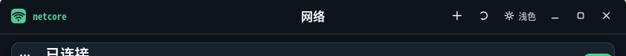

# 界面、主题与渲染

主窗口左上角显示自绘的 netcore 品牌标志和字标。任务栏/窗口管理器图标通过
GdkToplevel 的 icon list 在运行时设置，因此直接从源码构建、尚未安装图标主题时
也能显示；安装包另外安装同款 SVG 到 hicolor。

netcore-gui 使用 GTK4，但视觉系统不继承桌面主题。界面固定提供深色和浅色两套
调色板，启动默认深色；标题栏右侧的“浅色/深色”按钮可即时切换。主题切换会重新
加载应用级 CSS，并重绘所有自绘图标，不需要重启。

## 配色与系统独立性

- 深色：近黑蓝背景、深色卡片、青绿色强调色。
- 浅色：冷白背景、白色卡片、深绿色强调色。
- 两套颜色都直接写在应用 CSS 中，并使用高优先级 provider，覆盖桌面 GTK
  主题的按钮、输入框、开关、标题栏、滚动条、tooltip 和对话框配色。
- 原生标题栏按钮被隐藏，改用自绘的最小化、最大化/还原和关闭按钮；应用只会
  使用自己的两套颜色。
- 系统仍负责窗口阴影、窗口管理器的焦点/放置规则和鼠标指针；这些不属于应用
  控件，可能随桌面变化。

## 字体

启动时读取 GTK 的当前系统字体（gtk-font-name），用 Pango 解析字体族，并
通过应用 CSS 应用到所有控件。字体处理包括：

- 所有文本统一 bold（默认 700），标题更高字重。
- 启用 Xft 抗锯齿与轻 hinting，保持小字号清晰。
- 给标签添加极轻的文本阴影，作为统一的后期渲染效果；禁用 tooltip 等局部阴影
  以免过度模糊。
- 字号使用界面自己的层级，不跟随桌面的字号设置无限放大；字体族则明确来自
  当前系统。

检测到的字体族只用于应用 CSS 和 Pango 渲染，不显示状态文字。需要诊断时可在
启动时设置 NETCORE_DEBUG_ACCEL=1，将字体/GPU/CPU 信息输出到 stderr。

## 自绘图标

项目不使用系统图标主题。所有界面图标由 Cairo 在 24x24 网格上绘制：

- Wi-Fi 状态、以太网、信号强度条
- 锁、刷新、加号、关闭
- 最小化、最大化、还原
- 太阳/月亮主题切换
- 芯片（加速状态）、密码显示/隐藏眼睛
- 自定义旋转加载指示器

图标颜色继承当前应用 CSS 的前景色/强调色。应用图标
`org.netcore.NetworkManager.Gui.svg` 也是项目自绘并随核心文件安装。

## 显卡/CPU 加速检测

GTK 启动前，程序检查 `/dev/dri` 中是否存在 card/render 设备：

- 有 DRM 设备：保留 GSK 的默认 GPU 渲染路径，并读取活动 DRM 的 PCI ID，
  从 `pciconf -lv` 匹配显卡名称。
- 无 DRM 设备：设置 `GSK_RENDERER=cairo`，使用 CPU/Cairo 软件渲染。
- 用户显式设置 `GSK_RENDERER` 时不覆盖。

检测结果不占用界面。需要诊断时设置 NETCORE_DEBUG_ACCEL=1，启动日志会输出
GPU/CPU、GSK 渲染器和字体信息。检测只是可用性判断；具体光栅化路径仍由
GTK/GSK 和驱动决定。

## 启动参数

    netcore-gui                 # 默认深色
    netcore-gui --theme light   # 以浅色启动
    netcore-gui --bus session   # 开发会话总线

主题选择不写入配置；每次启动默认深色。

截图使用 mock 后端展示布局，不代表真实网络列表：

- 深色：[screenshot-gui.png](screenshot-gui.png)
- 浅色：[screenshot-gui-light.png](screenshot-gui-light.png)